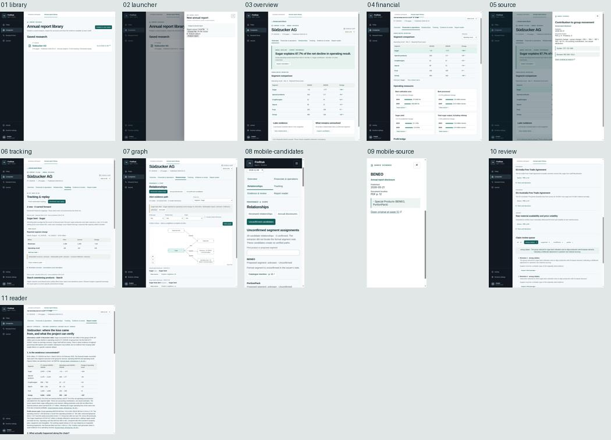

# Annual report workspace · product design review

**Verdict:** The Südzucker archive now supports a reproducible analyst journey: open a report, inspect the financial movement, follow an alert to a scoped business relationship, inspect the source, and return to the same row. The reviewed replay, fresh searches and annual disclosures retain separate identities. The interactive graph adds context without making an alert the cause of a segment's financial result.

Reviewed on 8 November 2026 with the existing annual run and its dated archives. Opening an existing result did not start a model run. Screenshots are from the running application, with the local API behind the normal frontend proxy. The narrow-screen check used a 390 × 844 viewport override. A separate browser tab verified the built Pages demo under its repository subpath, served by a plain static file server. No deployment or new live model benchmark was part of this review.

| Step | Result and usability finding | Evidence |
|---|---|---|
| 01 · Reopen | Pass. The library lists the issuer, period, source publication date, cutoff and available study lanes. Removed the unrelated Apple navigation and grouped the introduction under one heading. | [Library](01-library.jpg) |
| 02 · Start an analysis | Pass. Opens the document form directly. File and URL submissions create a job; closing and reopening the panel in the same tab resumes status checks. The resulting report is independently reopenable. A failed submission cannot create a completed report. Source handling, successful completion and failure were additionally exercised by API/component tests. | [Launcher](02-launcher.jpg) |
| 03 · Identify the movement | Pass. Five segments plus Group. The group operating result fell from EUR 350m to 163m. Sugar contributed −164m out of −187m, or 87.7% of the **net** decline. The summary links directly to the calculation. | [Overview](03-overview.jpg) |
| 04 · Inspect the accounts | Pass. The selected segment, measure, units, comparative periods and source remain together. Financials separates the operating bridge from cash/working capital. All 128 extracted rows can be searched. The chart displays 305,800 ha in English number formatting, and the separately published −2.8% for total output; it does not recompute the percentage from the rounded tonnes. | [Financials](04-financial.jpg) |
| 05 · Check the source | Pass. A named modal shows both quoted rows, the calculation, the physical and printed page and a direct PDF link. Tested reload with the modal open and Escape: focus returns to the originating control. | [Source and formula](05-source.jpg) |
| 06 · Replay by cutoff | Pass. Fresh lane: 0 new alerts in May, October and November; 1 / 3 / 3 eligible originals. Reviewed lane: no May snapshot, 2 new in October, the same 2 carried forward and none new in November. An unavailable path is explained and reappears on return. Forecast publication, alert detection and H1 reporting period are separately labelled. Policy evidence and scenario assumptions remain separate. | [October replay](06-tracking.jpg) |
| 07 · Follow an alert | Pass. The beet alert concerns sugar beet; Sugar uses sugar beet and reports a +EUR 26m H1 operating-result change. Both the labelled graph and the keyboard-accessible list retain the direction of each edge. Event-attributed profit and fulfilment remain unknown. For the second October alert, the Starch result changes by +EUR 7m. November has 34 nodes and 38 stored edges; 7 are model inferences and are off by default. The two separately extracted report relationships have their own evidence-linked graph. | [October graph and path list](07-graph.jpg) |
| 08 · Inspect abstentions on a phone | Pass. The six report views remain reachable. The 28 unknown product assignments are searchable, with no verified link or artificial “unknown segment” hub. No page-wide horizontal overflow was observed on this view. | [Candidate list](08-mobile-candidates.jpg) |
| 09 · Read a mobile citation | Pass. A full-width source sheet shows the catalogue wording and page. Its scope is a product mention, not support for a formal segment assignment. | [Mobile citation](09-mobile-source.jpg) |
| 10 · Review an unsupported claim | Pass. The queue distinguishes 8 supported, 4 insufficient, 1 partial and 1 wrong citation. The last case exposes all three attempts and the rejection reason. Unsuccessful reviewer quotes are labelled as text under review. | [Review queue](10-review.jpg) |
| 11 · Read the synthesis | Pass. The persistent English report is marked as analyst synthesis. Links open original disclosures or the corresponding saved research view. It is unavailable at earlier cutoffs. | [Report reader](11-reader.jpg) |

## Fixes verified during review

- The annual entry point no longer suggests that this report is the Apple dossier. Opening the launcher from the library no longer requires finding the document controls inside the unrelated company questionnaire.
- Some fresh snapshots store only changed graph nodes. The list of eligible originals now resolves each admitted digest using the current or an earlier manifest. It never looks ahead to complete an earlier snapshot.
- The acquisition log contains **3 searches and 21 document decisions**, not 24 searches. Rendering them as interchangeable records produced a blank page. After the fix the November page shows 0 new alerts, 3 eligible originals, the search leads and the separate admission decisions. The mixed log is covered by a frontend regression test.
- A direct source URL now restores keyboard focus to the originating control when dismissed after refresh. The narrow layout keeps view navigation visible and provides the same path list without requiring graph pan or zoom.

## Verification and limits

Frontend: **82 tests passed**; the local and GitHub Pages production builds passed. Backend: **1,050 non-integration tests passed**, 8 intentionally deselected; changed Python files passed Ruff. Tests cover date isolation, alert identity, saved originals, auth, URL/file jobs, failure states, chart figures and graph navigation. The PDF upload persistence test isolates the analyzer; the URL job test exercises the real XBRL parser with a local test document and a stubbed download. Neither test claims fresh public-site availability, inference quality or GPU performance.

This is a design and functional review of the new workspace. It is not a screen-reader certification or an extraction recall benchmark. New uploads show their own available annual analysis; reviewed replay, product audits and synthesis appear only when that report has an attached dataset. The live job runner is per API process: progress and completed results use a persistent filesystem ledger. For a multi-host deployment use a shared durable job queue and an appropriate access model. The static build contains only the explicitly archived public case.

## Follow-up: return from company research

Reproduced the old path from the October Sugar financials: **Company workspace** opened the AAPL overview. The replacement opens the issuer workspace within the selected filing's dataset, using the shared company section navigation. The issuer, cutoff and segment remain in scope, and a return link retains the exact originating report query. In the running app, we opened the two reviewed October alerts, refreshed the page, and returned to the original financials URL with Sugar selected. Visiting Today and then Companies also restored this filing's workspace in the same browser tab. The report library still provides a route to general company research. Independent company workflow runs are not implicitly joined to a filing; unsupported valuation and transcript comparisons have explicit empty states.

[Issuer workspace screenshot](company-context.jpg). Frontend regression suite after this change: 83 tests passed.
